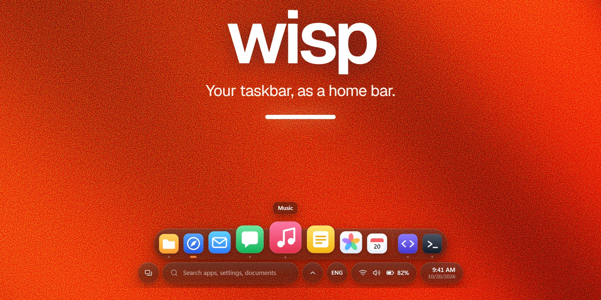
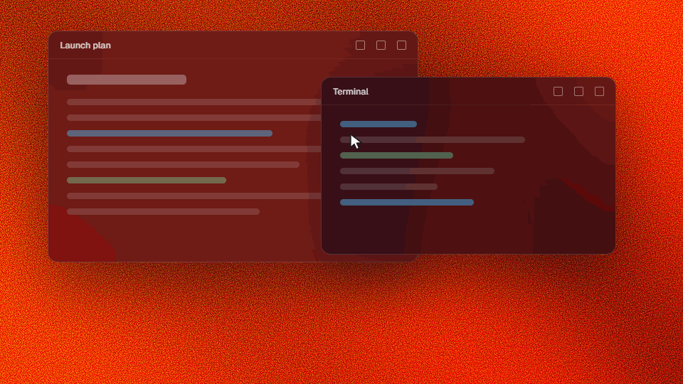
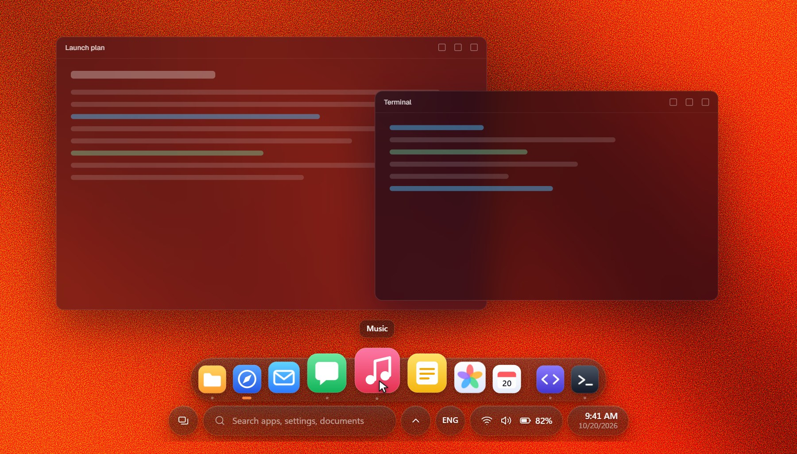
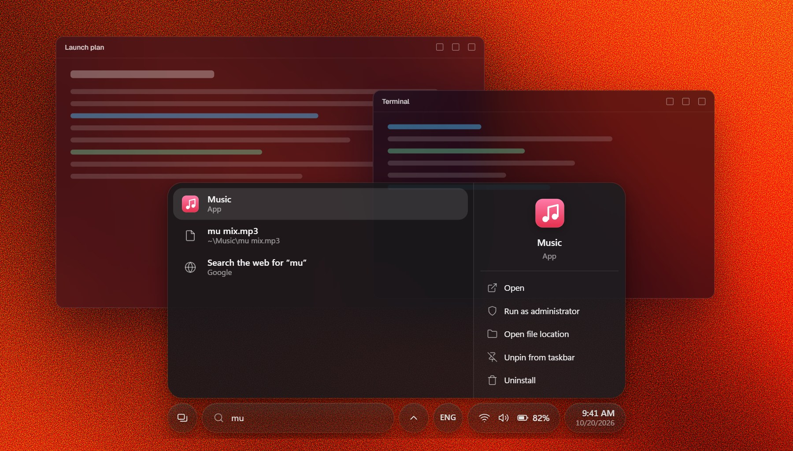
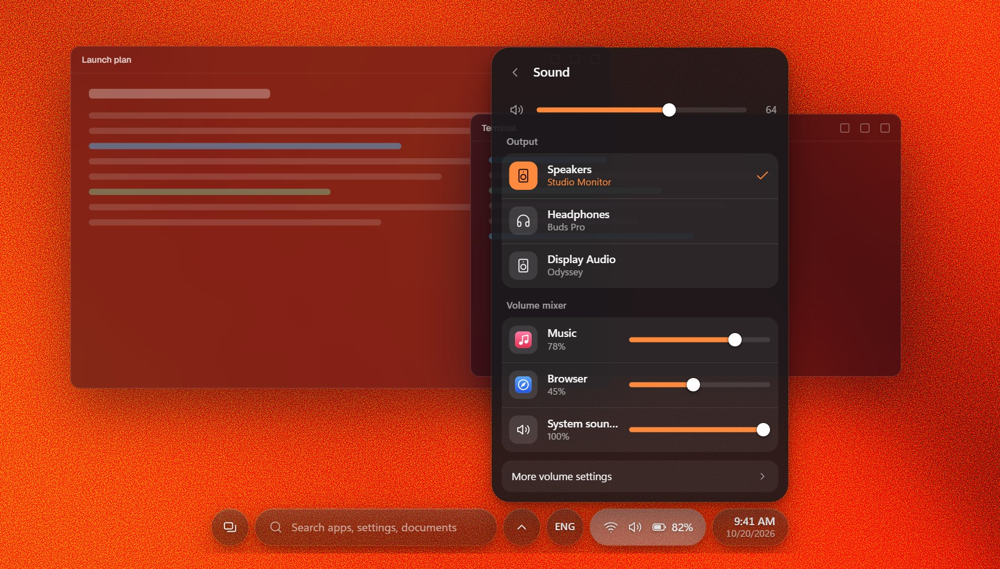
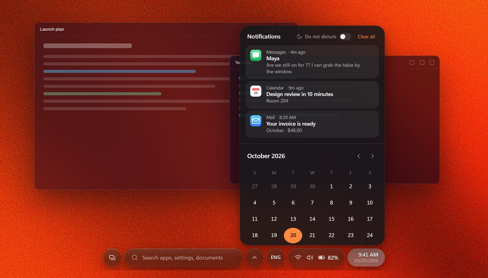
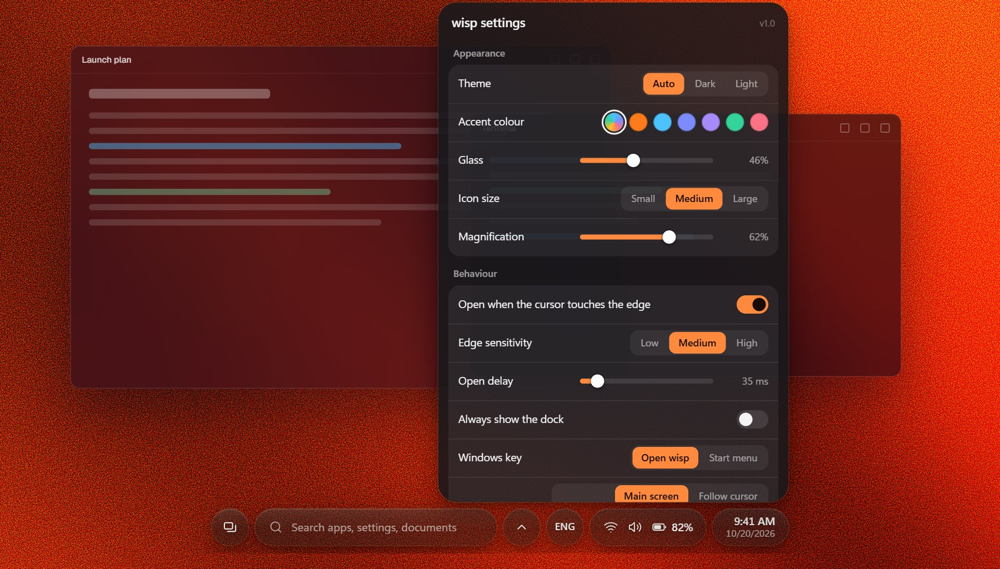
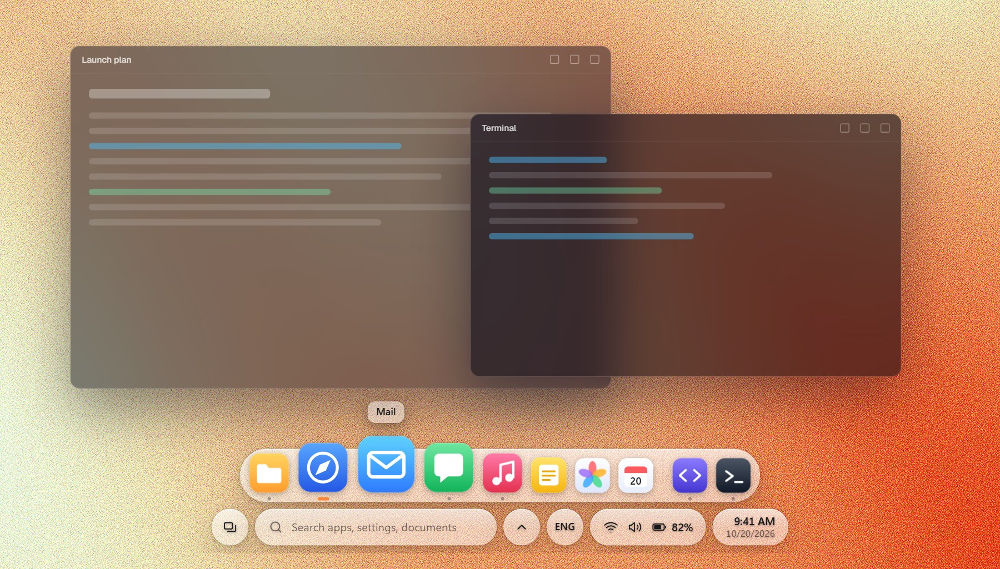

<div align="center">



<br>

[](https://github.com/chengxii-lii/wisp/releases)
[](#install)
[](LICENSE)
[](https://github.com/chengxii-lii/wisp/actions/workflows/ci.yml)

**Your Windows taskbar, as a phone-style home bar.**<br>
A thin pill that rises to meet your cursor, opens into a dock, and holds search, quick settings and notifications.

</div>

<br>



<br>

<table>
<tr>
<td width="50%" valign="top">
<br>
<b>Out of the way until you want it.</b> Nothing on screen, then a pill that leans toward your cursor, then a dock that opens when you touch the bottom edge. Icons grow as you sweep across them.
</td>
<td width="50%" valign="top">
<br>
<b>Tap the Windows key and type.</b> Apps, settings, files and power commands, with the same actions Windows search gives you: run as administrator, open file location, pin to taskbar.
</td>
</tr>
<tr>
<td width="50%" valign="top">
<br>
<b>Quick settings that go all the way.</b> Join Wi-Fi with a password, connect Bluetooth headphones, choose where sound plays and mix each app's volume, without opening Settings.
</td>
<td width="50%" valign="top">
<br>
<b>Notifications that behave.</b> Popups appear above the bar and leave on their own, today's list lives under the clock (swipe to dismiss, or clear them all), and Do not disturb is one switch.
</td>
</tr>
<tr>
<td width="50%" valign="top">
<br>
<b>Make it yours.</b> Theme, accent, glass, icon size, magnification, how close the cursor must get, a delay, one screen or all of them, 24-hour clock, and which buttons show.
</td>
<td width="50%" valign="top">
<br>
<b>Light or dark,</b> following Windows or your choice. Everything is drawn from one set of tokens, so a new accent colour recolours the lot.
</td>
</tr>
</table>

**Also:** your pinned apps, in your Windows order · running apps with dots · drag to reorder · a window picker for apps with several windows · right-click menus like the taskbar's (close, end task, run as administrator, pin) · hidden-icons menu · input language switcher · Task view and Show desktop · power menu · no telemetry.

## Install

1. Download **wisp-v1.0.0-win-x64.zip** from the [latest release](https://github.com/chengxii-lii/wisp/releases/latest) and unzip it.
2. Double-click **Install wisp.cmd**. (No admin rights needed. Prefer to look first? Run `wisp\wisp.exe` straight from the folder; nothing is installed.)

Windows may say the app is unrecognised, because wisp isn't code-signed yet: choose **More info**, then **Run anyway**. Its code is all here, and the helper is a few readable C# files ([`helper/`](helper)).

On first run wisp hides the Windows taskbar and takes over. Quit it from the right-click menu and the taskbar comes back, exactly as it was.

**Requires** Windows 11 (built and tested there; Windows 10 is untested).

## Use it

| Do this | To get |
| :-- | :-- |
| Move toward the bottom edge | A pill fades in and leans toward your cursor |
| Touch the bottom edge | The dock opens, with search, status and the clock below it |
| <kbd>Win</kbd> | Open wisp with search ready (tap again to close). Set it to open Start instead in Settings |
| <kbd>Enter</kbd> · <kbd>Ctrl</kbd> <kbd>Shift</kbd> <kbd>Enter</kbd> | Open the result · run it as administrator |
| Click an app with several windows | Pick the window |
| Drag a pinned app | Reorder the dock |
| Right-click anything | The menu you'd expect there. Right-click empty bar for **wisp settings** |
| <kbd>Esc</kbd> | Close |

## Make it yours

Right-click the empty bar and choose **wisp settings**. Everything saves as you change it, and **Restore defaults** is one click. Settings live in `%APPDATA%\wisp\config.json`.

<details>
<summary><b>How it works</b></summary>
<br>

- **One window, mostly invisible.** An Electron window sits at the bottom centre of your screen, transparent and click-through everywhere except the pieces you can see, so it never blocks the apps underneath.
- **A native helper does what a web page can't.** A small C# program, built with the compiler that ships with Windows, hides the real taskbar, listens for the Windows key, lists your windows, extracts high-resolution icons, switches sound outputs and keyboard languages, relays tray icons, and talks to the Bluetooth audio driver. The two halves talk over JSON lines.
- **Two cursor zones, spring physics.** The pill, the dock and every panel move on springs, so interruptions look natural instead of snapping.
- **Your taskbar, read honestly.** Pins come from the same places Windows keeps them, in the order the taskbar shows. wisp's own pin changes are layered on top and never touch Windows' list.
- **Notifications** are read from the notification database Windows already keeps, shown by wisp, and Windows' own banners are muted per app while it runs (restored when you quit).
- **Hidden icons.** wisp registers its own tray window, forwards every message to Explorer's real one unchanged, and relays your clicks, so nothing is lost if you quit.

</details>

<details>
<summary><b>If something goes wrong</b></summary>
<br>

wisp puts the taskbar back whenever it exits, and when its window crashes. The one case it can't cover is both of its processes being force-killed at the same instant (some "end task" tools do that). If the taskbar is ever missing, run `restore-taskbar.ps1` (it's in the zip and next to the installed app), or restart Windows Explorer from Task Manager. A crash log is kept at `%APPDATA%\wisp\wisp.log`.

**Uninstall:** run `uninstall.ps1` (add `-RemoveData` to delete your settings too).

</details>

<details>
<summary><b>Privacy</b></summary>
<br>

No analytics, accounts or servers. Everything stays on your PC. The only time wisp touches the internet is when you pick a web search, which opens your browser. Your notification list is stored locally and clears itself at the end of the day.

</details>

<details>
<summary><b>Known limits</b></summary>
<br>

- Modern Store apps that live inside Windows' app frame (Settings, Calculator) don't show as running dots yet.
- Task view, Show desktop and the multi-monitor modes send the same keys and use the same display information Windows does, but have had less testing than the rest.
- Bluetooth Connect works for audio devices (headphones, speakers). Phones and controllers show their status only, because Windows offers no way to connect them from another app.
- Not code-signed yet, so SmartScreen will ask once.

</details>

<details>
<summary><b>Development</b></summary>
<br>

Needs Windows, Node 22+, and the .NET Framework 4 compiler that ships with Windows (nothing to install).

```bash
npm install
npm run helper    # build the native helper
npm start         # run from source
npm test          # fast checks: syntax, ids, IPC, settings
npm run pack      # package the app into dist/
npm run zip       # build the release zip
npm run art       # re-render this README's art
```

The UI can be developed in any browser: serve `renderer/` and open it, and `renderer/mock.js` stands in for Electron. `docs/ideas.md` has the reasoning behind the settings.

</details>

<sub>Thanks to [ShaderGradient](https://shadergradient.co) for the gradients, [Electron](https://www.electronjs.org) for the window, and [Geist](https://vercel.com/font) (OFL) for the banner's type. The app icons in the screenshots are drawn for this repo. MIT licensed.</sub>
